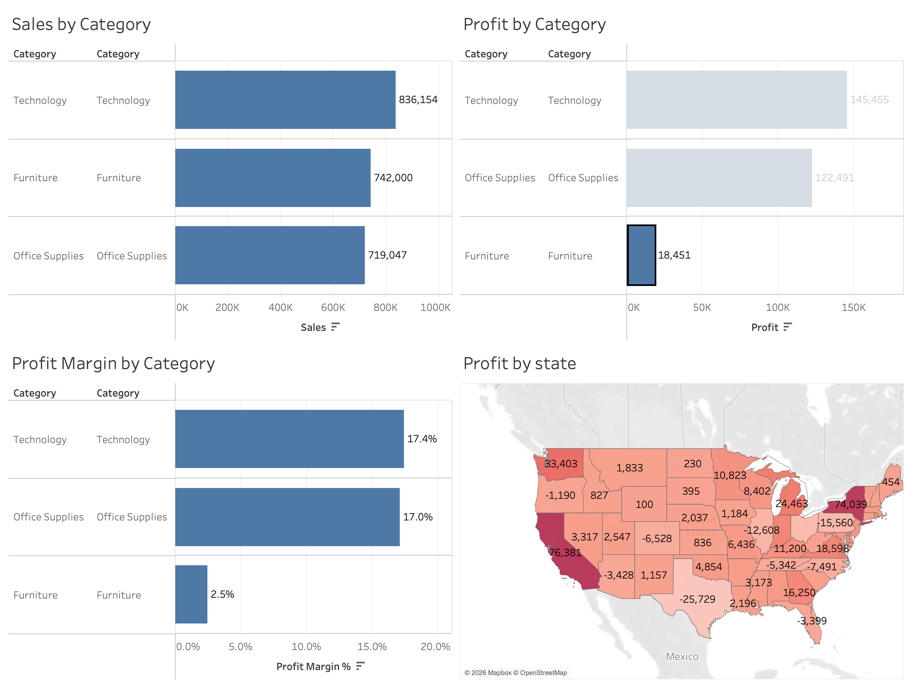
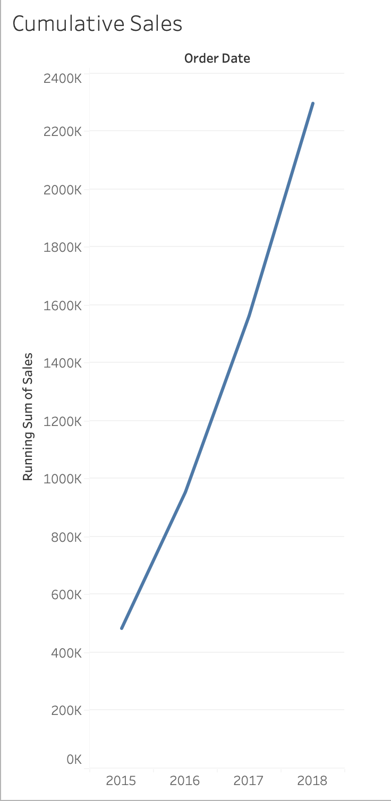
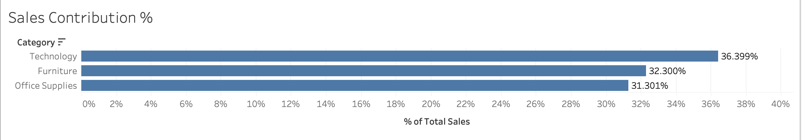

# Superstore Sales & Profitability — Tableau Hands-On Practice

[](https://public.tableau.com/app/profile/harkamal.toor)


**Explore retail sales, category profitability, US state-level profit, and cumulative revenue using Tableau.**

This repository documents a **hands-on Tableau learning exercise** using the Sample Superstore dataset. It covers the complete beginner workflow: connecting a CSV, building charts, writing calculated fields, using table calculations, and assembling an interactive dashboard.

**Built with:** Tableau Public · Calculated Fields · Table Calculations · Geographic Maps · Filters & Dashboard Layout

## Live Tableau views

| View | What you can explore |
| --- | --- |
| **[Open the Sales & Profit Dashboard ↗](https://public.tableau.com/app/profile/harkamal.toor/viz/CumulativeSales_17920806063360/SuperstoreSalesProfit)** | Compare category sales, profit, margins and state-level results |
| **[Open Cumulative Sales ↗](https://public.tableau.com/app/profile/harkamal.toor/viz/CumulativeSales_17920806063360/CumulativeSales)** | Running total of sales across years |
| **[Open Sales Contribution ↗](https://public.tableau.com/app/profile/harkamal.toor/viz/CumulativeSales_17920806063360/SalesContribution)** | Each category's share of total revenue |

These are three **views in the published Tableau Public workbook**. The images below are static previews; use the links above for the published Tableau experience.

### Dashboard preview

[](https://public.tableau.com/app/profile/harkamal.toor/viz/CumulativeSales_17920806063360/SuperstoreSalesProfit)

### Additional visualizations

| Cumulative sales | Sales contribution |
| --- | --- |
| [](https://public.tableau.com/app/profile/harkamal.toor/viz/CumulativeSales_17920806063360/CumulativeSales) | [](https://public.tableau.com/app/profile/harkamal.toor/viz/CumulativeSales_17920806063360/SalesContribution) |
| [Explore the live view ↗](https://public.tableau.com/app/profile/harkamal.toor/viz/CumulativeSales_17920806063360/CumulativeSales) | [Explore the live view ↗](https://public.tableau.com/app/profile/harkamal.toor/viz/CumulativeSales_17920806063360/SalesContribution) |

## Questions I explored

1. Which product categories drive the most **sales** and **profit**?
2. Can a category generate high revenue but have a low **profit margin**?
3. What **percentage of total sales** does each category contribute?
4. Which US states show **positive or negative profit**?
5. How does **cumulative revenue** change across years?

## Key results

These figures refer to the **unfiltered** Sample Superstore data in this repository. Selections in Tableau can change displayed numbers.

| Summary metric | Value |
| --- | ---: |
| Total sales | **$2,297,201** |
| Total profit | **$286,397** |
| Overall profit margin | **12.5%** |
| Data size | **9,994 line items** |
| Period | **2015–2018** |

| Category | Sales | Profit | Profit margin | Share of sales |
| --- | ---: | ---: | ---: | ---: |
| Technology | $836,154 | $145,455 | 17.4% | 36.4% |
| Furniture | $742,000 | $18,451 | 2.5% | 32.3% |
| Office Supplies | $719,047 | $122,491 | 17.0% | 31.3% |

**Takeaway:** Furniture produces more revenue than Office Supplies, yet contributes substantially less profit. Looking at sales alone would obscure this difference. This is a descriptive finding, not evidence that any particular factor *caused* lower margins.

## Skills practiced

| Topic | Tableau work |
| --- | --- |
| Data connection | Imported CSV; inspected dates, measures, dimensions and geographic fields |
| Visual comparisons | Sales, profit and margin by category |
| Calculated fields | Profit margin as an aggregated ratio |
| Geospatial analysis | Filled map of profit by US state |
| Interactive analysis | Region, Category and Year filters; dashboard exploration |
| Table calculations | Percent of Total and Running Total |
| Dashboard design | Combined four analysis views into one Tableau dashboard |

### Core formulas

**Profit Margin %** — aggregated ratio (format as percentage):

```tableau
SUM([Profit]) / SUM([Sales])
```

**Sales Contribution %** — compute across categories:

```tableau
SUM([Sales]) / TOTAL(SUM([Sales]))
```

**Cumulative Sales** — compute along the ordered year axis:

```tableau
RUNNING_SUM(SUM([Sales]))
```

For table calculations, **Compute Using** matters: choose the correct direction and partition so percentages and running totals are calculated over the intended records.

## Repository contents

```text
.
├── README.md
├── Superstore_Tableau_Practice.twbx
├── Sales Contribution.twbx
├── Cumulative Sales.twbx
├── data/
│   └── superstore.csv
└── assets/
    ├── dashboard.png
    ├── cumulative-sales.png
    └── sales-contribution.png
```

- **[Main Tableau workbook](./Superstore_Tableau_Practice.twbx)** — practice worksheets and the combined dashboard.
- **[Sales Contribution workbook](./Sales%20Contribution.twbx)** — percent-of-total exercise.
- **[Cumulative Sales workbook](./Cumulative%20Sales.twbx)** — running-total exercise.
- **[Source CSV](./data/superstore.csv)** — dataset for rebuilding the visuals.
- **[Screenshots](./assets/)** — visual previews.

### Reproduce the exercise

1. Install [Tableau Public](https://www.tableau.com/products/public) or use Tableau Desktop.
2. Download and open the [packaged workbook](./Superstore_Tableau_Practice.twbx) to explore the work.
3. Alternatively, connect Tableau to [`data/superstore.csv`](./data/superstore.csv) and build new worksheets from scratch.
4. Verify date types, numerical fields and the `State` geographic role; set the country context to the **United States** if states show as unknown.
5. Try rebuilding a category bar chart, profit-margin calculation, map, filters and a running-total line chart.

## Acknowledgment and scope

- **Dataset:** Sample Superstore, used for learning and demonstration.
- **Learning reference and original example:** [Ana Paula Borges — tableau-sales-profitability-dashboard](https://github.com/ANAPBORGES/tableau-sales-profitability-dashboard). Her repository includes the CSV, workbook examples, calculations and design guidance.
- **This repository:** A record of my hands-on Tableau practice and published visualizations. It is not represented as an original commercial project or independently collected data.

**Author:** [Harkamal Toor](https://github.com/htoor2026) · [Tableau Public profile](https://public.tableau.com/app/profile/harkamal.toor)
